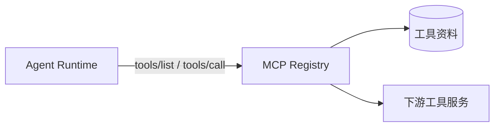

<p align="center">
  
</p>

# g2rain-mcp-registry

[](LICENSE)
[](https://openjdk.org/)
[](https://spring.io/projects/spring-boot)
[](https://spring.io/projects/spring-cloud)
[](https://maven.apache.org/)

G2rain（谷雨）是面向企业的开源智能体平台，连接模型、知识与业务工具，以 SaaS 基座和应用开发工具链支撑智能应用落地。智能体平台已开源，具体组件、版本与接入方式以各责任仓库的说明为准。`g2rain-mcp-registry` 是其中的 MCP 工具目录、协议适配与下游调用代理服务：它维护外部服务与工具资料，解析工具输入 schema，并在 `/mcp` 上为 Agent Runtime 提供工具发现与调用代理；它不代表或替代整个平台、Agent Studio、Agent Runtime、Model Nexus、Gateway 或部署编排的能力。

[官网](https://www.g2rain.com) · [完整文档](docs/index.md) · [中央架构 Profile](https://github.com/g2rain/g2rain/tree/architecture-v1.0.0/docs/architecture/profiles/java-domain-service) · [架构说明](docs/architecture/overview.md) · [本地开发](docs/development/local-development.md) · [Issues](https://github.com/g2rain/g2rain/issues) · [Discussions](https://github.com/g2rain/g2rain/discussions)

## 项目定位

MCP Registry 负责工具能力的目录、协议适配与下游调用边界。Agent Studio 在 Agent/Skill 中选择工具，Agent Runtime 使用 MCP 协议发现和调用工具；模型访问由 Model Nexus 独立负责。

## 功能概览

| 能力 | 说明 |
| --- | --- |
| 服务与工具资料 | 管理 MCP 外部服务和工具档案。 |
| 工具发现 | 通过 `/mcp` 处理 `tools/list`，按可用工具资料返回定义。 |
| 工具调用代理 | 通过 `tools/call` 组装请求上下文和输入 schema，调用下游服务并映射结果或错误。 |
| 主体上下文转发 | 在可信边界内向下游工具传递必要的主体上下文。 |

## 核心流程



1. 管理端维护 MCP 外部服务与工具资料。
2. Runtime 通过 `/mcp` 请求工具目录，Registry 返回可发现的工具定义。
3. Runtime 调用工具时，Registry 解析 schema、组装可信上下文、访问下游服务并返回 MCP 结果。

## 工程结构

| 模块 | 说明 |
| --- | --- |
| `g2rain-mcp-registry-api` | 提供工具元数据、查询条件及 API 契约。 |
| `g2rain-mcp-registry-biz` | 实现资料管理、schema、请求上下文、工具列表与调用处理器。 |
| `g2rain-mcp-registry-startup` | 组装 Spring Boot 与 MCP Server。 |

模块依赖方向固定为：`startup → biz → api`。

## 技术栈

| 类别 | 技术 |
| --- | --- |
| 运行时 | Java 25、Spring Boot 4.1.2、Spring Cloud 2025.1.4、Spring AI 2.0.2 |
| 数据访问 | MyBatis、MySQL、MapStruct |
| 平台基础设施 | Redis、Nacos、OpenFeign、Spring Cloud Stream |
| 协议与文档 | MCP、SpringDoc、OpenAPI |
| 构建与部署 | Maven、Jib、Docker |
| 测试 | Spring Boot Test、JUnit |

## 快速开始

### 环境

前置条件：JDK 25、Maven，以及可用的 MySQL、Redis 和本地联调所需的下游 MCP 服务。默认 profile 为 `nacos`；如需本地联调，使用 `dev` 并在本机安全地提供配置。

### 构建与测试

```bash
mvn clean verify
```

### 启动服务

```powershell
mvn -pl g2rain-mcp-registry-startup -am spring-boot:run "-Dspring-boot.run.profiles=dev"
```

端口由 `SERVER_PORT` 环境变量控制，未设置时为 `8080`。共享环境应通过 Nacos 和环境变量管理服务地址与凭据，禁止将真实凭据写入版本库。

## 接口与配置

| 入口/配置 | 用途 |
| --- | --- |
| `/mcp` | MCP HTTP 端点，处理工具发现和工具调用。 |
| `/mcp_external_service` | 查询、保存和删除 MCP 外部服务资料。 |
| `/mcp_tool_profile` | 查询、保存和删除 MCP 工具资料。 |
| `SERVER_PORT` | HTTP 端口，默认 `8080`。 |
| `SPRING_PROFILES_ACTIVE` | 默认 `nacos`；本地可显式使用 `dev`。 |
| `NACOS_SERVER_ADDR` | Nacos 注册与配置中心地址。 |

当前配置声明 `STATELESS` MCP 协议，而部分源码注释描述 `STREAMABLE` 分支；实际协议和会话语义应以集成测试验证结果为准。

## 构建与验证

| 目标 | 命令 | 说明 |
| --- | --- | --- |
| 构建与验证 | `mvn clean verify` | 执行 Maven 验证生命周期。 |
| 启动服务 | `mvn -pl g2rain-mcp-registry-startup -am spring-boot:run -Dspring-boot.run.profiles=dev` | 本地联调使用独立开发环境。 |
| 构建本地镜像 | `./build.sh <tag>` | 使用 Jib 构建 `ghcr.io/g2rain/g2rain-mcp-registry:<tag>`。 |

## GHCR 镜像

- 镜像地址：`ghcr.io/g2rain/g2rain-mcp-registry`。
- 稳定版使用 `1.0.0` 这类版本标签，并同时发布 `sha-<完整提交 SHA>` 可追溯标签；不会更新 `latest`。
- 包公开后可拉取：`docker pull ghcr.io/g2rain/g2rain-mcp-registry:1.0.0`。
- 仅推送精确格式的 `v<major>.<minor>.<patch>` Git tag 才会触发发布；tag 提交必须在 `main` 历史中，并含同名发布说明。

完整的 GHCR 权限、首次公开、发布顺序、配置与部署说明见[构建与部署](docs/operations/deployment.md)。

## 协作关系

- **Agent Studio** 负责在 Agent 配置中选择和组合工具能力。
- **Agent Runtime** 从注册中心获取 MCP 工具，并在任务执行期间调用。
- **Model Nexus** 与本模块相互独立：前者提供模型能力，后者提供工具能力。

## 安全与运维

- 下游 URL、凭据、Token、工具参数和结果可能包含敏感信息，只可由受控配置提供并在日志中脱敏。
- 写工具需要明确授权、幂等、确认与审计；不得以“内网服务”替代访问控制。
- 上线前验证 `/mcp` 路由、协议模式、工具 schema、主体上下文转发、超时、错误映射和下游健康状态。

## 项目文档

| 场景 | 入口 |
| --- | --- |
| 文档首页 | [docs/index.md](docs/index.md) |
| 架构与模块 | [架构总览](docs/architecture/overview.md) · [模块与依赖](docs/architecture/modules.md) · [运行流程](docs/architecture/runtime-flows.md) |
| 本地开发与测试 | [本地开发](docs/development/local-development.md) · [测试](docs/development/testing.md) |
| API 与数据 | [API/数据](docs/development/api-database.md) |
| 配置、安全与部署 | [配置](docs/operations/configuration.md) · [安全边界](docs/security/security-boundaries.md) · [构建与部署](docs/operations/deployment.md) |
| 发布说明 | [v1.0.0](docs/releases/v1.0.0.md) |

## 贡献

欢迎通过 Issue、文档改进、功能建议和 Pull Request 参与贡献。提交前请执行 `mvn clean verify`，并同步协议、schema、配置、安全和架构文档。

## 许可证

本项目基于 [Apache 2.0 许可证](LICENSE) 开源。
